# Архитектура Inspecto

> Краткий обзор. Подробное описание каждого компонента, каждого взаимодействия (инициатор, получатель, протокол, endpoint, данные, формат, ответ, ошибки) и все диаграммы — в документе [`architecture/INSPECTO_SYSTEM_ARCHITECTURE.md`](architecture/INSPECTO_SYSTEM_ARCHITECTURE.md), из которого собирается [`INSPECTO_SYSTEM_ARCHITECTURE.pdf`](architecture/INSPECTO_SYSTEM_ARCHITECTURE.pdf). Это единственный подробный источник; здесь — только сводка, чтобы не допустить расхождений.

## Статус

Версия 0.2 — **спроектированная** архитектура (CP0). Реализация не начата.

## Компоненты

| Компонент | Репозиторий | Технология | Ответственность |
|---|---|---|---|
| Android-приложение | `android` | Kotlin, Jetpack Compose | Основной клиент: проведение осмотра на объекте, камера, черновики |
| Web-приложение | `web` | Next.js, TypeScript | Просмотр и редактирование, сравнение, отчёты, статистика |
| nginx | `platform/deploy` | nginx | Единая точка входа: TLS, маршрутизация, rate limiting |
| core-service | `core-service` | Java, Spring Boot | Аутентификация, объекты, осмотры, чек-листы, дефекты, сравнение, статистика |
| media-service | `media-service` | Go | Загрузка, обработка, хранение и выдача фотографий |
| report-service | `report-service` | Go + Gotenberg | Асинхронная генерация PDF-отчётов |
| ml-service | `ml` | Python, ONNX Runtime | Подсказка категории дефекта по фото |
| PostgreSQL 16 | `platform/deploy` | — | Отдельная база на каждый сервис |
| SeaweedFS | `platform/deploy` | — | Файлы фотографий и отчётов |



## Ключевые решения

| Тема | Решение | ADR |
|---|---|---|
| Границы сервисов | Ядро бизнес-логики на Java + сервисы обработки файлов на Go + ML на Python | ADR-002 |
| Модель дефекта | `Defect` (на уровне объекта) + `DefectObservation` (в каждом осмотре) | ADR-003 |
| Сравнение осмотров | Новый / устранённый / оставшийся / не проверен | ADR-004 |
| Данные | Один PostgreSQL, отдельная база на сервис; файлы в SeaweedFS | ADR-005, ADR-006 |
| Аутентификация | JWT RS256 от core, проверка по JWKS во всех сервисах; ротация refresh-токенов | ADR-007, ADR-008 |
| Межсервисное взаимодействие | Синхронный REST; асинхронность — таблицы заданий, без брокера | ADR-010, ADR-011 |
| PDF | HTML-шаблон → Gotenberg во внутренней сети без интернета | ADR-012 |
| Маршрутизация | nginx по ресурсам, внутренние API наружу не публикуются | ADR-013 |
| Контракты | OpenAPI 3.1 contract-first в `platform/api` | ADR-014 |

## Документы по теме

- [DATABASE.md](DATABASE.md) — схема данных.
- [API_DOCUMENTATION.md](API_DOCUMENTATION.md) — каталог API.
- [SECURITY.md](SECURITY.md), [THREAT_MODEL.md](THREAT_MODEL.md) — безопасность.
- [DECISIONS.md](DECISIONS.md) — журнал решений.

## Сборка архитектурного PDF

```bash
cd docs/architecture
npm install          # mermaid-cli и puppeteer
./build.sh           # нужны pandoc ≥ 3 и pdftotext (poppler-utils)
```

Диаграммы — исходники Mermaid в `architecture/diagrams/*.mmd`; отрисованные SVG коммитятся в `architecture/out/`, чтобы они отображались на GitHub.
