<!-- markdownlint-disable MD025 MD036 -->

# Сведения о документе {.unnumbered}

| Параметр | Значение |
|---|---|
| Документ | Архитектура информационной системы Inspecto |
| Версия | 0.1 — предварительная (этап проектирования, контрольная точка CP0) |
| Статус | Проект. Описывает **спроектированную** архитектуру; реализация ещё не начата |
| Источник | `platform/docs/architecture/INSPECTO_SYSTEM_ARCHITECTURE.md` (сборка: `docs/architecture/build.sh`) |
| Связанные документы | DECISIONS.md (ADR), DATABASE.md, API_DOCUMENTATION.md, SECURITY.md, THREAT_MODEL.md |

**Порядок актуализации.** Документ обновляется в каждом PR, который меняет архитектуру, состав сервисов, контракты API или схему данных. Финальная версия (CP7) приводится в соответствие с фактически реализованной системой; расхождения между документом, кодом и OpenAPI-спецификациями не допускаются.

**Принятые сокращения.** API — программный интерфейс; ADR — запись архитектурного решения; JWT — JSON Web Token; JWKS — набор открытых ключей JWT; DFD — диаграмма потоков данных; ER — диаграмма «сущность — связь»; MVP — минимально жизнеспособная версия; RBAC — ролевое управление доступом; S3 — протокол объектного хранилища.

# Легенда обозначений

Цветовое кодирование компонентов одинаково на всех архитектурных диаграммах.

| Обозначение | Значение |
|---|---|
| Голубой блок | Клиентское приложение (Android, Web) |
| Фиолетовый блок | Пограничный компонент (nginx) |
| Оранжевый блок | Сервис на Java (core-service) |
| Бирюзовый блок | Сервис на Go (media-service, report-service) |
| Жёлтый блок | Сервис на Python (ml-service) |
| Серый блок / цилиндр | Инфраструктура и хранилища (PostgreSQL, MinIO, Gotenberg) |
| Сплошная стрелка | Синхронный запрос (HTTP/REST); направление — от инициатора к получателю |
| Пунктирная стрелка | Вспомогательное взаимодействие (получение открытых ключей, кешируется) |
| Номер на диаграмме последовательности | Порядок шагов сценария |
| Блоки `alt` / `opt` / `loop` / `par` | Альтернативы (в т. ч. ошибки), необязательный шаг, цикл, параллельное выполнение |

# Общее описание архитектуры

Inspecto — клиент-серверная информационная система для структурированного документирования технического состояния квартир, домов и коммерческих помещений. Пользователь (профессиональный инспектор или частный владелец) создаёт объект недвижимости, проводит осмотры по чек-листам, фиксирует дефекты с фотографиями, формирует PDF-отчёт и при повторном осмотре сравнивает результаты.

Архитектурный стиль — **микросервисы с прагматичными границами** (ADR-002). Бизнес-логика, связанная транзакциями (пользователи, объекты, осмотры, дефекты, сравнение), сосредоточена в одном сервисе на Java. В отдельные сервисы выделены функции с другим профилем нагрузки и отказов: обработка фотографий и генерация PDF (Go), классификация изображений (Python).

Основные принципы:

1. **Единая точка входа.** Клиенты обращаются только к nginx; топология сервисов клиентам неизвестна (ADR-013).
2. **Изоляция данных.** У каждого сервиса своя база в общем экземпляре PostgreSQL; файлы — в MinIO; общих таблиц нет (ADR-005, ADR-006).
3. **Контракты прежде реализации.** Все API описаны в OpenAPI 3.1; клиенты генерируют код из спецификаций (ADR-014).
4. **Локальная проверка токенов.** JWT выдаёт core-service, остальные сервисы проверяют подпись по открытому ключу без сетевого вызова (ADR-007).
5. **Деградация вместо отказа.** Недоступность media, report или ml отключает одну функцию, а не систему целиком.
6. **Безопасность по умолчанию.** Проверка прав на каждый ресурс, внутренние API недоступны снаружи, минимальные привилегии в СУБД (SECURITY.md).

# Общая архитектурная схема


*Рисунок 1 — Общая архитектурная схема информационной системы Inspecto*

Клиенты (Android и Web) взаимодействуют с серверной частью по HTTPS. nginx завершает TLS, применяет ограничения частоты запросов и размеров тела и маршрутизирует запросы по ресурсам: фотографии — в media-service, отчёты — в report-service, всё остальное — в core-service. Сервисы взаимодействуют между собой по внутренней сети через REST, хранят данные в своих базах PostgreSQL и в объектном хранилище MinIO. Gotenberg — изолированный компонент преобразования HTML в PDF.


*Рисунок 2 — Сетевые зоны развёртывания (docker compose)*

Сетевые зоны реализуются отдельными сетями docker compose. Наружу опубликован только порт nginx. Сети `app`, `data` и `render` помечены как внутренние; Gotenberg не имеет выхода в интернет, что исключает загрузку внешних ресурсов при рендеринге (защита от SSRF).

# Микросервисы и их ответственность


*Рисунок 3 — Диаграмма микросервисов и внутренних API*

## core-service

| Параметр | Значение |
|---|---|
| Технология | Java (LTS), Spring Boot, Spring Security, Spring Data JPA, Flyway |
| Ответственность | Регистрация и аутентификация, выдача JWT и сервисных токенов, пользователи и роли; объекты и помещения; справочники (категории, шаблоны чек-листов, шкала серьёзности); осмотры и чек-листы; дефекты, наблюдения, история статусов; сравнение осмотров; статистика; ML-подсказки (оркестрация и учёт решений); удаление данных |
| Данные | База `inspecto_core`: users, refresh_tokens, service_clients, properties, rooms, property_access*, defect_categories, checklist_templates, checklist_template_items, inspections, inspection_checklist_items, defects, defect_observations, observation_photos, defect_status_history, ml_suggestions, outbox_events (*этап расширения) |
| Внешний API | `/api/v1/auth/**`, `/users/**`, `/properties/**`, `/rooms/**`, `/inspections/**`, `/checklist-items/**`, `/defects/**`, `/observations/**`, `/defect-categories/**`, `/checklist-templates`, `/category-suggestions`, `/.well-known/jwks.json` |
| Внутренний API | `/internal/v1/auth/service-token`, `/internal/v1/access/properties/{id}`, `/internal/v1/inspections/{id}/report-data` |
| Зависимости | PostgreSQL; media-service (проверка и привязка фото, удаление); report-service (удаление отчётов); ml-service (классификация, необязательная) |

## media-service

| Параметр | Значение |
|---|---|
| Технология | Go, chi, pgx, minio-go, golang-migrate |
| Ответственность | Приём фотографий, проверка типа по сигнатуре и лимитов, защита от «бомб распаковки», удаление EXIF, сжатие и варианты (оригинал, превью, миниатюра), хранение, выдача с проверкой прав, очистка неприкреплённых фото |
| Данные | База `inspecto_media`: photos; бакет MinIO `photos` |
| Внешний API | `GET /api/v1/photos/limits`, `POST /api/v1/photos`, `GET /api/v1/photos/{id}/content`, `DELETE /api/v1/photos/{id}` |
| Внутренний API | `GET /internal/v1/photos/{id}`, `POST /internal/v1/photos/{id}/attach`, `GET /internal/v1/photos/{id}/content`, `DELETE /internal/v1/photos` |
| Зависимости | PostgreSQL, MinIO; core-service (проверка прав, сервисный токен, JWKS) |

## report-service

| Параметр | Значение |
|---|---|
| Технология | Go, chi, pgx, minio-go, `html/template`; Gotenberg |
| Ответственность | Приём заданий на отчёт, асинхронная генерация PDF пулом воркеров, повторы, хранение и выдача PDF с проверкой прав |
| Данные | База `inspecto_report`: report_jobs; бакет MinIO `reports` |
| Внешний API | `POST /api/v1/reports`, `GET /api/v1/reports/{id}`, `GET /api/v1/reports?inspectionId=`, `GET /api/v1/reports/{id}/file` |
| Внутренний API | `DELETE /internal/v1/reports` |
| Зависимости | PostgreSQL, MinIO, Gotenberg; core-service (права, данные осмотра); media-service (изображения) |

## ml-service

| Параметр | Значение |
|---|---|
| Технология | Python, FastAPI, ONNX Runtime, Pillow |
| Ответственность | Классификация фотографии дефекта: top-3 категорий с вероятностями, версия модели |
| Данные | Без базы; файл модели ONNX — артефакт версии сервиса |
| Внутренний API | `POST /internal/v1/classify`, `GET /internal/v1/model` |
| Зависимости | media-service (изображение), core-service (сервисный токен, JWKS). Сервис **необязателен**: при его отказе подсказки не показываются |

## Инфраструктурные компоненты

| Компонент | Назначение |
|---|---|
| nginx | TLS, HSTS и заголовки безопасности, CORS, маршрутизация, rate limiting, лимиты тела запроса |
| PostgreSQL 16 | Три базы, у каждого сервиса свой пользователь с минимальными правами, TLS-соединения |
| MinIO | Объектное хранилище, бакеты `photos` и `reports`, недоступно снаружи |
| Gotenberg | HTML → PDF (headless Chromium) во внутренней сети без выхода в интернет |

# Взаимодействие Java- и Go-сервисов

Взаимодействие core-service (Java) с media-service и report-service (Go) — синхронный REST во внутренней сети (ADR-010). Каждый вызов несёт сервисный токен и заголовок `X-Request-Id`.

Все взаимодействия этого раздела: протокол HTTP/1.1, стиль REST, формат JSON (кроме J1 и J6), аутентификация сервисным токеном (кроме J1 и J8).

| № | Инициатор → получатель | Endpoint | Данные → ответ | Обработка ошибок |
|---|---|---|---|---|
| J1 | media, report, ml → core | `POST /internal/v1/auth/service-token` | `client_id`, `client_secret` (form-urlencoded) → `200 {access_token, expires_in}` | `401` — сервис не стартует (ошибка конфигурации); токен кешируется до истечения |
| J2 | media, report → core | `GET /internal/v1/access/properties/{id}?userId&action` | Параметры запроса → `200 {allowed: true}` или `404` | Таймаут 2 с, 2 повтора; core недоступен — клиенту `503 DEPENDENCY_UNAVAILABLE`; положительный ответ кешируется на 60 с |
| J3 | core → media | `GET /internal/v1/photos/{id}` | — → `200 {ownerId, propertyId, status}` | `404` — клиенту `400 VALIDATION_ERROR` (фото не найдено или чужое) |
| J4 | core → media | `POST /internal/v1/photos/{id}/attach` | — → `204` | Идемпотентен; media недоступен — `503`, транзакция core откатывается |
| J5 | report → core | `GET /internal/v1/inspections/{id}/report-data` | — → `200` агрегат осмотра | Таймаут 10 с; ошибка — повтор задания (до 3 раз) |
| J6 | report → media | `GET /internal/v1/photos/{id}/content?variant=preview` | — → `200 image/jpeg` | Отсутствующее фото заменяется заглушкой с пометкой; прочие ошибки — повтор задания |
| J7 | core (outbox) → media, report | `DELETE /internal/v1/photos?propertyId=`, `DELETE /internal/v1/reports?propertyId=` | Параметры → `204` | Идемпотентны; повторы с экспоненциальной задержкой до успеха |
| J8 | media, report, ml → core | `GET /.well-known/jwks.json` | — → `200` JWKS | Кеш ключей 10 мин; неизвестный `kid` — повторная загрузка |

Взаимодействия ML1 и ML2 описаны в разделе «Взаимодействие с ML-сервисом», G1 — в разделе «Формирование PDF-отчётов».

Согласованность форматов обеспечивается OpenAPI-спецификациями внутренних API: Java-сторона генерирует серверные интерфейсы, Go-сторона — клиентские типы, интеграционные тесты сверяют ответы со спецификацией.

# Взаимодействие Backend с Web-приложением

Web-приложение (Next.js) — клиент того же внешнего API, что и Android. Приложение работает в браузере пользователя и обращается к `https://<host>/api/v1` через nginx; сервер Next.js отдаёт статические ресурсы и не проксирует бизнес-запросы (одна модель авторизации для двух клиентов).

| Аспект | Решение |
|---|---|
| Протокол и формат | HTTPS, REST, JSON; файлы — `multipart/form-data` и `application/pdf` |
| Аутентификация | Access-токен в памяти вкладки; refresh-токен — cookie `HttpOnly; Secure; SameSite=Strict; Path=/api/v1/auth` (ADR-008) |
| Обновление токена | При ответе `401 TOKEN_EXPIRED` клиент вызывает `POST /api/v1/auth/refresh` с заголовком `X-CSRF-Protection: 1` и повторяет исходный запрос один раз |
| Типы и клиент | Генерация TypeScript-типов из OpenAPI (openapi-typescript); запросы через TanStack Query (кеш, повторы, состояние загрузки) |
| Ошибки | Разбор `application/problem+json` по полю `code`, локализованные сообщения из словарей next-intl; ошибки полей выводятся рядом с полями формы |
| Фото | Загрузка `POST /api/v1/photos`; отображение `GET /api/v1/photos/{id}/content?variant=thumb\|preview` |
| Отчёты | `POST /api/v1/reports` → опрос статуса каждые 2 с → скачивание файла |
| CORS | Разрешён только origin веб-приложения, `credentials: true` для эндпоинтов аутентификации |

# Взаимодействие Backend с Android-приложением

Android — основной клиент: работа на объекте, часто при нестабильной связи.

| Аспект | Решение |
|---|---|
| Протокол и формат | HTTPS, REST, JSON (Retrofit + kotlinx.serialization); клиент генерируется из OpenAPI |
| Аутентификация | `POST /api/v1/auth/login` с `client: "android"`; refresh-токен в теле ответа; хранение в DataStore, зашифрованном ключом Android Keystore |
| Обновление токена | OkHttp Authenticator: при `401 TOKEN_EXPIRED` — `POST /api/v1/auth/refresh {refreshToken}` и повтор запроса; одновременные запросы ждут одного обновления |
| Черновики | Незавершённый осмотр хранится в Room; отправка при наличии сети. Полная офлайн-синхронизация — этап расширения |
| Фото | CameraX → сжатие на устройстве → очередь WorkManager (повторы с экспоненциальной задержкой, `Idempotency-Key`, только при наличии сети) |
| Конфликты | `409 VERSION_CONFLICT` — приложение загружает актуальную версию и показывает пользователю расхождение |
| Ошибки | Разбор `problem+json` по коду; строки сообщений в ресурсах Android (локализация) |
| Сеть | Таймауты подключения 10 с, чтения 30 с (загрузка фото — 60 с); запрет cleartext-трафика (`network_security_config`) |

# Взаимодействие с ML-сервисом

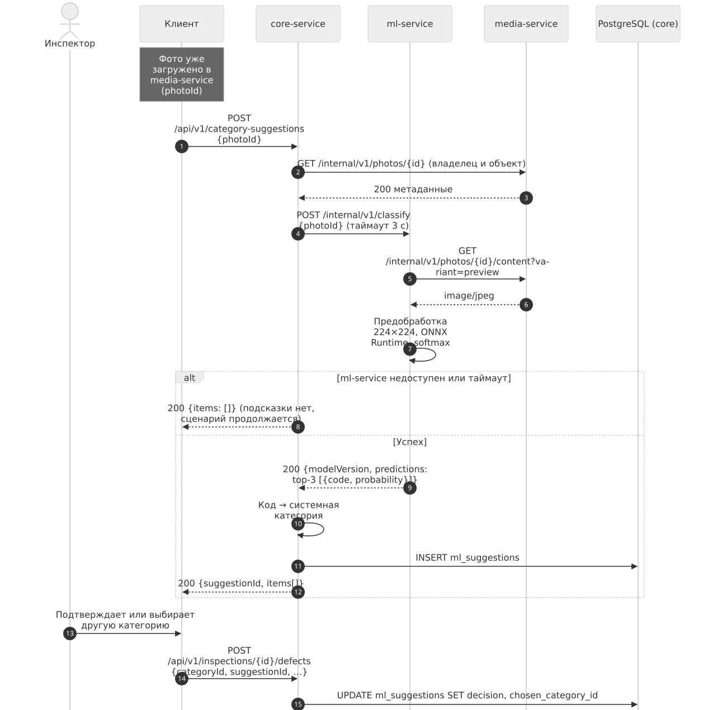

*Рисунок 4 — Диаграмма последовательности получения подсказки категории дефекта*

| Шаг | Инициатор → получатель | Endpoint и данные | Ответ | Ошибки |
|---|---|---|---|---|
| 1 | Клиент → core | `POST /api/v1/category-suggestions`, `{photoId}` | `200 {suggestionId, modelVersion, items[]}` | `404` — чужое фото |
| 2 | core → media (J3) | `GET /internal/v1/photos/{id}` | Метаданные | `404` — клиенту `400` |
| 3 (ML1) | core → ml | `POST /internal/v1/classify`, `{photoId}` | `{modelVersion, predictions[{code, probability}]}` | Таймаут 3 с без повторов; любая ошибка — клиенту `200 {items: []}` |
| 4 (ML2) | ml → media | `GET /internal/v1/photos/{id}/content?variant=preview` | `image/jpeg` | Ошибка — `503` для core (далее как в шаге 3) |
| 5 | Клиент → core | `POST /api/v1/inspections/{id}/defects` с `suggestionId` | `201` | Решение пользователя записывается в `ml_suggestions.decision` |

Подсказка носит рекомендательный характер: категорию всегда подтверждает пользователь. Запись решения (`ACCEPTED_TOP1`, `ACCEPTED_OTHER`, `REJECTED`) даёт реальную метрику полезности модели в эксплуатации. ml-service получает изображение сам из media-service, поэтому байты фото не проходят через core.

# Архитектура баз данных

Используется один экземпляр PostgreSQL 16 с отдельной базой и отдельным пользователем на каждый сервис (ADR-005). Межсервисные ссылки — UUID без внешних ключей; их целостность обеспечивают внутренние API (`attach`) и задания очистки.

| База | Владелец | Основные таблицы | Пользователь |
|---|---|---|---|
| `inspecto_core` | core-service | users, refresh_tokens, properties, rooms, defect_categories, checklist_templates, inspections, inspection_checklist_items, defects, defect_observations, observation_photos, defect_status_history, ml_suggestions, outbox_events | `core_app` |
| `inspecto_media` | media-service | photos | `media_app` |
| `inspecto_report` | report-service | report_jobs | `report_app` |

Ключевое решение модели — разделение **дефекта** и **наблюдения** (ADR-003): дефект принадлежит объекту и помещению и существует дольше одного осмотра, а каждый осмотр фиксирует наблюдение этого дефекта. Это делает возможным сравнение осмотров по идентификатору дефекта.


*Рисунок 5 — ER-диаграмма базы core-service: пользователи, объекты, справочники (ключевые атрибуты)*


*Рисунок 6 — ER-диаграмма базы core-service: осмотры, чек-листы, дефекты и наблюдения (ключевые атрибуты)*


*Рисунок 7 — ER-диаграмма баз media-service и report-service и межсервисные ссылки*

*Рисунок 8 — Диаграмма состояний дефекта*

Полное описание столбцов, ограничений и индексов — DATABASE.md.

# Загрузка, хранение и получение фотографий

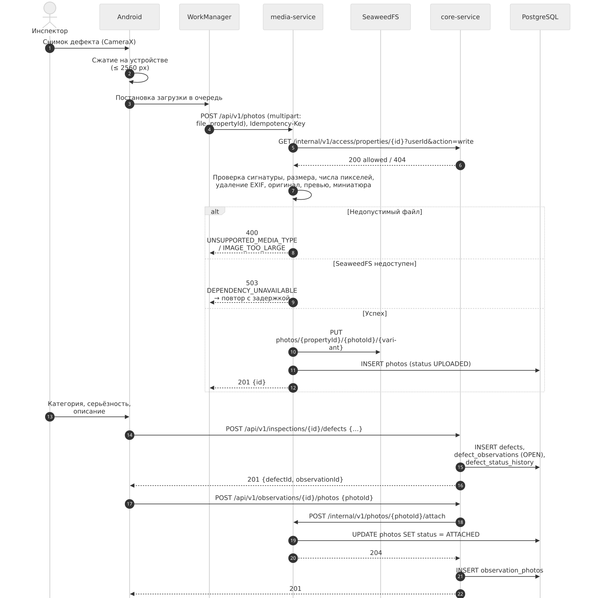

*Рисунок 9 — Диаграмма последовательности регистрации дефекта и загрузки фотографии*

**Загрузка.** Клиент сжимает изображение на устройстве и отправляет `POST /api/v1/photos` (`multipart/form-data`: `file`, `propertyId`; заголовок `Idempotency-Key`). media-service:

1. проверяет JWT и право записи в объект (J2);
2. проверяет размер тела и тип файла **по сигнатуре** (JPEG, PNG, WebP), а не по расширению;
3. читает размеры изображения до декодирования и отклоняет изображения сверх лимита пикселей;
4. декодирует, удаляет метаданные EXIF (в т. ч. геолокацию), формирует варианты: оригинал (длинная сторона ≤ 2560 px), превью (≈1280 px, используется в PDF и ML), миниатюра (≈320 px);
5. сохраняет варианты в MinIO по ключу `photos/{propertyId}/{photoId}/{variant}` и метаданные с SHA-256 в базе (`status = UPLOADED`);
6. возвращает `201 {id, contentType, width, height, sizeBytes}`.

**Привязка.** Фото привязывается к наблюдению дефекта через core (`POST /api/v1/observations/{id}/photos`), core проверяет фото (J3) и помечает его прикреплённым (J4). Фото, не привязанные в течение 24 часов, удаляются фоновой задачей media-service.

**Получение.** `GET /api/v1/photos/{id}/content?variant=…` — media-service проверяет права (J2), читает объект из MinIO и отдаёт его потоком с `Cache-Control: private, max-age=…`. Прямых ссылок на MinIO клиенты не получают.

**Лимиты** (допустимые типы, максимальный размер файла, максимум фото на наблюдение) задаются конфигурацией media-service и публикуются `GET /api/v1/photos/limits`, чтобы клиенты проверяли их до отправки.

# Формирование PDF-отчётов

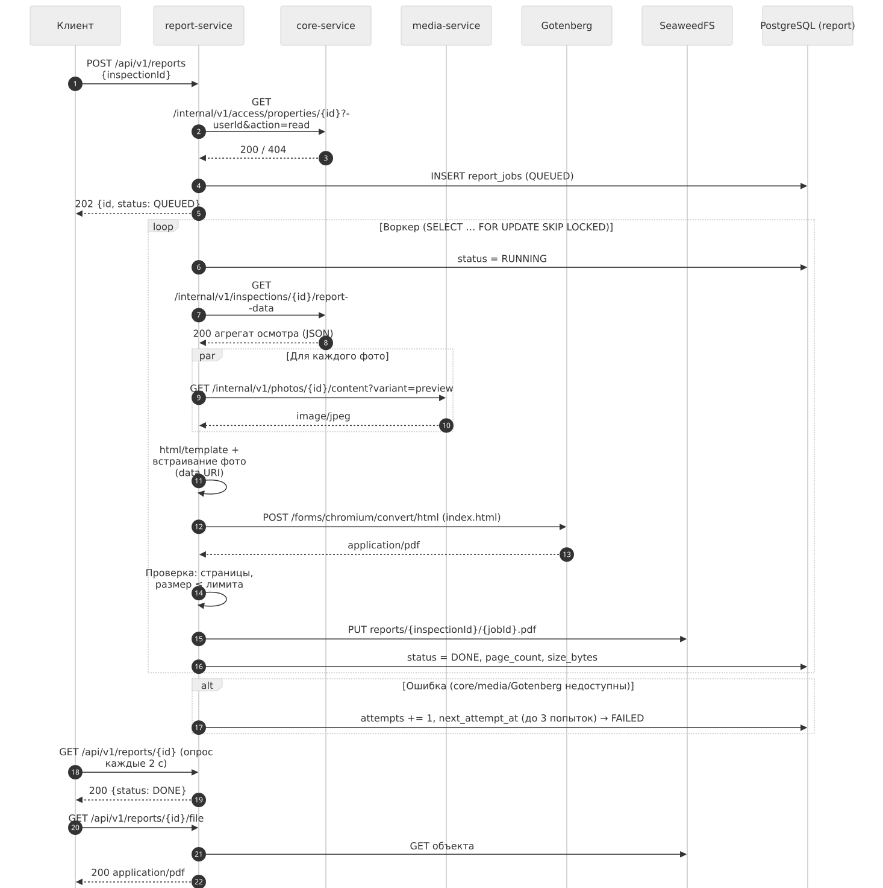

*Рисунок 10 — Диаграмма последовательности формирования PDF-отчёта*

Генерация асинхронная (ADR-011): `POST /api/v1/reports {inspectionId}` проверяет права, создаёт задание `QUEUED` и сразу возвращает `202 Accepted`. Пул воркеров report-service забирает задания запросом `SELECT … FOR UPDATE SKIP LOCKED`, что позволяет безопасно запускать несколько экземпляров сервиса.

Шаги воркера:

1. получить агрегат осмотра из core (J5): объект, помещения, чек-лист, дефекты, наблюдения, идентификаторы фото, сводку;
2. получить превью фото из media (J6);
3. сформировать HTML из шаблона `html/template` (автоматическое экранирование пользовательского текста), встроив изображения как `data:`-URI; шаблоны разделены по локали;
4. отправить HTML в Gotenberg (G1: `POST /forms/chromium/convert/html`, `multipart/form-data`), получить `application/pdf`;
5. проверить результат (число страниц, размер не больше лимита) и сохранить в MinIO `reports/{inspectionId}/{jobId}.pdf`;
6. отметить задание `DONE` с `page_count` и `size_bytes`.

Состав отчёта: титульная информация об объекте и осмотре; сводка (число дефектов по серьёзности и категориям); результаты чек-листа по помещениям; дефекты с описанием, серьёзностью, статусом, комментариями и фотографиями; для повторного осмотра — раздел сравнения с предыдущим. Вёрстка использует `break-inside: avoid` для карточек дефектов и колонтитулы с номерами страниц.

Ошибки: недоступность core, media или Gotenberg — повтор с экспоненциальной задержкой (до 3 попыток), затем `FAILED` с кодом ошибки; клиент видит статус и может запросить отчёт повторно.

# Аутентификация и авторизация

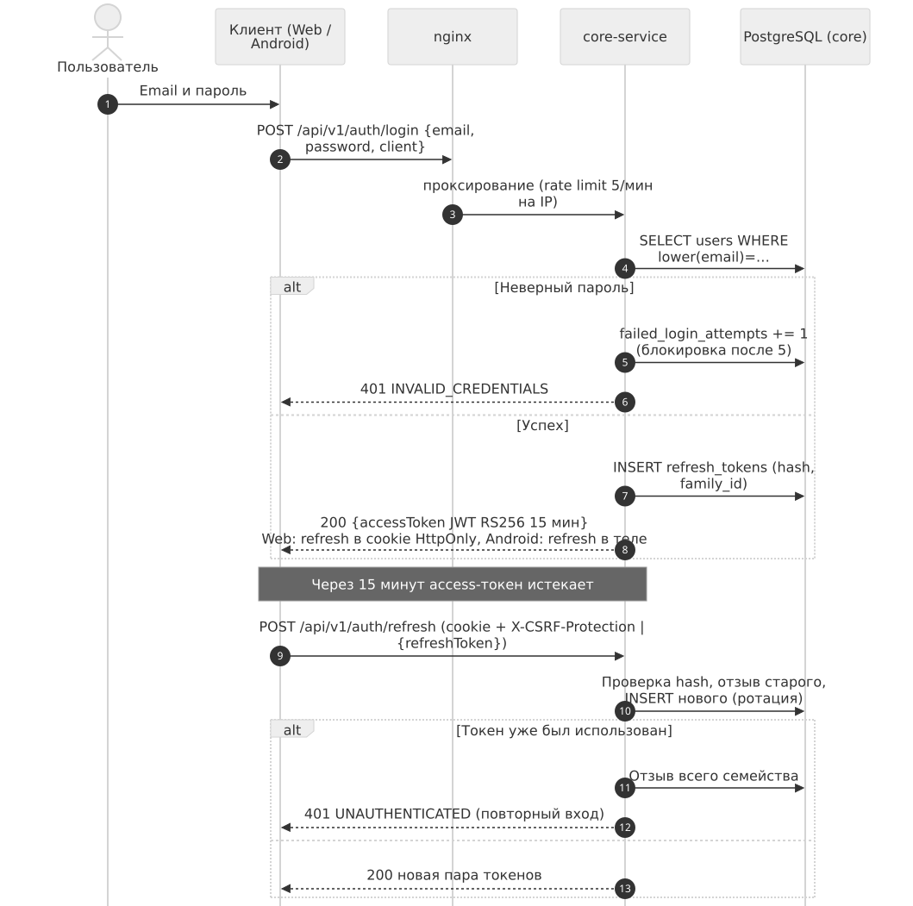

*Рисунок 11 — Диаграмма последовательности входа и обновления токенов*

| Механизм | Решение |
|---|---|
| Пароли | Argon2id; минимальная длина 10; проверка по списку распространённых паролей |
| Access-токен | JWT RS256, 15 минут; claims: `sub` (id пользователя), `role`, `iat`, `exp`, `iss`, `aud=inspecto-api`, `jti`; ключ подписи с `kid` для ротации |
| Refresh-токен | Случайная строка 256 бит, 30 дней; в базе только SHA-256; ротация при каждом использовании; повторное использование отозванного токена отзывает всё семейство (признак кражи) |
| Защита от перебора | Rate limit на nginx (5 запросов в минуту с IP на `/auth/login`); блокировка учётной записи на 15 минут после 5 неудачных попыток |
| Проверка в сервисах | core — Spring Security Resource Server; Go и Python — проверка подписи по JWKS (кеш), `iss`, `aud`, `exp` |
| Роли (RBAC) | `ADMIN`, `INSPECTOR` (MVP), `CLIENT` (этап расширения) — ADR-009 |
| Права на ресурс | Каждый запрос проверяет владение объектом (или выданный доступ). Чужой ресурс — `404`, чтобы не раскрывать его существование |
| Межсервисная аутентификация | Сервисные токены (client credentials) с `aud=inspecto-internal`; внутренние endpoints не опубликованы через nginx и не принимают пользовательские токены |

# REST API и основные маршруты

Все внешние маршруты имеют префикс `/api/v1`. Полный каталог с параметрами — API_DOCUMENTATION.md, формальная спецификация — `platform/api/*.yaml`.

| Группа | Сервис | Основные маршруты |
|---|---|---|
| Аутентификация | core | `POST /auth/register`, `/auth/login`, `/auth/refresh`, `/auth/logout` |
| Профиль | core | `GET/PATCH/DELETE /users/me`, `POST /users/me/password` |
| Объекты | core | `GET/POST /properties`, `GET/PATCH/DELETE /properties/{id}`, `POST /properties/{id}/archive` |
| Помещения | core | `GET/POST /properties/{id}/rooms`, `PATCH/DELETE /rooms/{id}` |
| Справочники | core | `GET /defect-categories`, `GET /checklist-templates`, `GET /dictionaries/severities` |
| Осмотры | core | `GET/POST /properties/{id}/inspections`, `GET/PATCH/DELETE /inspections/{id}`, `POST /inspections/{id}/complete` |
| Чек-листы | core | `PATCH /checklist-items/{id}`, `POST /inspections/{id}/checklist-items` |
| Дефекты | core | `GET /properties/{id}/defects`, `POST /inspections/{id}/defects`, `GET/PATCH /defects/{id}`, `GET /defects/{id}/history` |
| Наблюдения | core | `GET /inspections/{id}/open-defects`, `POST /inspections/{id}/observations`, `POST /observations/{id}/photos` |
| Сравнение, статистика | core | `GET /inspections/compare?base&target`, `GET /properties/{id}/statistics` |
| ML-подсказки | core | `POST /category-suggestions` |
| Фотографии | media | `GET /photos/limits`, `POST /photos`, `GET /photos/{id}/content`, `DELETE /photos/{id}` |
| Отчёты | report | `POST /reports`, `GET /reports/{id}`, `GET /reports?inspectionId`, `GET /reports/{id}/file` |

Общие правила: JSON UTF-8; время ISO 8601 UTC; пагинация `page/size`; оптимистическая блокировка полем `version`; ошибки RFC 9457 с машиночитаемым `code`; `X-Request-Id` во всех ответах.

# Механизмы передачи данных между сервисами

| Механизм | Где используется | Характеристики |
|---|---|---|
| Синхронный REST (JSON) | Все межсервисные запросы (J1–J8) | Таймауты 2–10 с; повторы только для идемпотентных запросов (до 2); сквозной `X-Request-Id`; сервисный JWT |
| Потоковая передача бинарных данных | Байты изображений (media → report, ml), PDF (MinIO → report → клиент) | Без загрузки целиком в память там, где это возможно; лимиты размера |
| Таблица заданий в базе сервиса | Генерация PDF (`report_jobs`) | Надёжная очередь без брокера; `FOR UPDATE SKIP LOCKED`; повторы с задержкой |
| Outbox в базе core | Очистка файлов при удалении (`outbox_events`) | Задание создаётся в той же транзакции, что и удаление данных; обработчик вызывает J7 до успеха |
| Объектное хранилище S3 | Фото и PDF | Доступ только у сервиса-владельца бакета |

Брокер сообщений не используется (ADR-010): обе асинхронные задачи надёжно решаются таблицами в базах сервисов.

# Обработка ошибок и отказов компонентов

**Единый формат ошибок** — RFC 9457 (`application/problem+json`) с полями `code`, `requestId` и, для валидации, `errors[]`. Внутренние подробности (стек, SQL) клиенту не передаются, а пишутся в структурированный лог с тем же `requestId`.

| Отказ | Поведение системы | Видимый эффект |
|---|---|---|
| core-service недоступен | Вход, осмотры и дефекты недоступны; media и report отвечают `503` на операции, требующие проверки прав (кеш прав 60 с смягчает короткие сбои) | Android сохраняет изменения в черновике |
| media-service недоступен | Загрузка фото — `503`; Android держит фото в очереди WorkManager и повторяет; привязка фото к наблюдению откатывается; отчёты ждут повтора | Фото загрузятся позже |
| report-service или Gotenberg недоступны | Задания остаются в очереди или повторяются; после 3 попыток — `FAILED` | Пользователь видит статус и повторяет запрос |
| ml-service недоступен | Таймаут 3 с, подсказка пустая | Категорию выбирают вручную; основной сценарий не прерывается |
| PostgreSQL недоступен | Сервисы отвечают `503`; `/health/ready` возвращает ошибку | Временная недоступность |
| MinIO недоступен | Загрузка и выдача файлов — `503`; генерация отчётов повторяется | Тексты и данные доступны, файлы — нет |
| Конкурентное изменение | Оптимистическая блокировка → `409 VERSION_CONFLICT` | Клиент показывает актуальную версию |
| Повтор запроса после сбоя сети | `Idempotency-Key` для загрузки фото и создания отчёта | Нет дубликатов |

Каждый сервис публикует `/health/live` (процесс жив) и `/health/ready` (доступны его зависимости) для docker compose.

# Последовательности основных пользовательских сценариев

## Создание осмотра

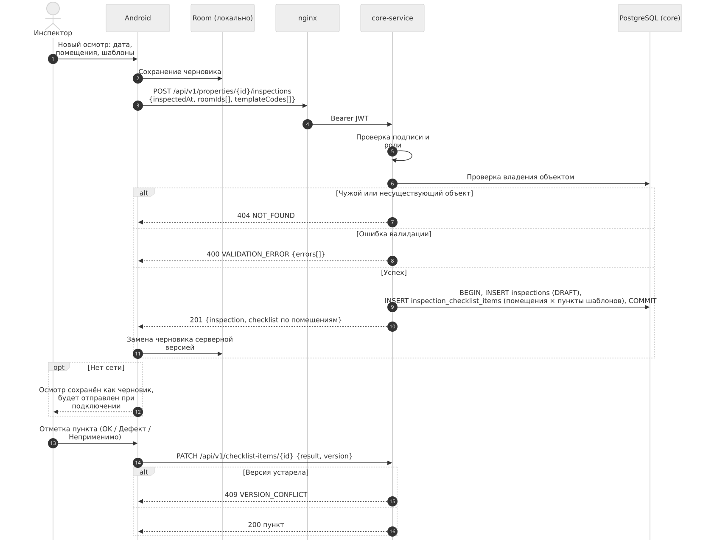

*Рисунок 12 — Диаграмма последовательности создания осмотра и заполнения чек-листа*

Участвуют: Android, nginx, core-service, PostgreSQL. Осмотр создаётся одной транзакцией вместе с пунктами чек-листа (помещения × пункты выбранных шаблонов). До ответа сервера осмотр хранится как локальный черновик.

## Сценарии и участвующие сервисы

| Сценарий | Инициатор | Сервисы | Диаграмма |
|---|---|---|---|
| Вход и обновление токена | Клиент | nginx, core | Рисунок 11 |
| Создание объекта и помещений | Клиент | nginx, core | — (CRUD) |
| Создание осмотра, заполнение чек-листа | Android | nginx, core | Рисунок 12 |
| Регистрация дефекта с фото | Android | nginx, media, core, MinIO | Рисунок 9 |
| Подсказка категории | Клиент | core, ml, media | Рисунок 4 |
| Формирование PDF | Клиент | report, core, media, Gotenberg, MinIO | Рисунок 10 |
| Повторный осмотр | Android | core (+ media для новых фото) | Рисунки 8, 9 |
| Сравнение осмотров | Клиент | core | — (один запрос, правила ADR-004) |
| Удаление объекта | Клиент | core → (outbox) → media, report | — |

## Повторный осмотр и сравнение

1. Пользователь создаёт новый осмотр того же объекта.
2. Клиент запрашивает `GET /api/v1/inspections/{id}/open-defects` — список дефектов, открытых по последним наблюдениям.
3. Для каждого проверенного дефекта пользователь **явно** выбирает «остался» (`OPEN`) или «устранён» (`RESOLVED`), при необходимости добавляет фото; замена фото статус не меняет.
4. Новые дефекты регистрируются как обычно.
5. `GET /api/v1/inspections/compare?base={A}&target={B}` возвращает сводку по четырём состояниям (ADR-004): **новый**, **устранённый**, **оставшийся**, **не проверен** — с разбивкой по категориям и серьёзности.

## Поток данных


*Рисунок 13 — Диаграмма потоков данных (DFD) информационной системы*

DFD показывает шесть основных процессов системы, хранилища данных и потоки между пользователем, процессами и хранилищами. Процессы 1, 2 и 4 реализуются core-service, процесс 3 — media-service, процесс 5 — report-service, процесс 6 — ml-service.

# Перечень рисунков {.unnumbered}

1. Общая архитектурная схема информационной системы Inspecto.
2. Сетевые зоны развёртывания.
3. Диаграмма микросервисов и внутренних API.
4. Диаграмма последовательности получения подсказки категории дефекта.
5. ER-диаграмма базы core-service: пользователи, объекты, справочники.
6. ER-диаграмма базы core-service: осмотры, чек-листы, дефекты и наблюдения.
7. ER-диаграмма баз media-service и report-service.
8. Диаграмма состояний дефекта.
9. Диаграмма последовательности регистрации дефекта и загрузки фотографии.
10. Диаграмма последовательности формирования PDF-отчёта.
11. Диаграмма последовательности входа и обновления токенов.
12. Диаграмма последовательности создания осмотра.
13. Диаграмма потоков данных.
